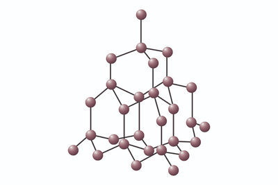
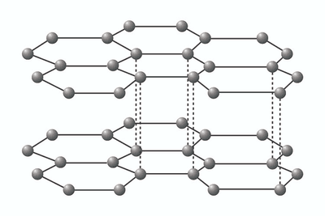
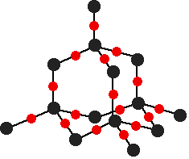

## Giant Covalent Structures

**Giant Covalent (Macromolecular) Structures**: solids with very high melting points, where all the atoms are made of non-metals, mostly including carbon, silicon and oxygen, held together by continuous strong covalent bonds.

### **Diamond**                      

### **Properties**

 1. Each carbon atom is joined with **four other carbon atoms**
 2. **High Melting and Boiling Points** - Strong Covalent Bonds
 3. **No Delocalised/Free Moving Electrons**
 4. It cannot be scratched easily
 5. Transparent colour (Extra information)
 6. Cannot conduct electricity **due to no free-moving electrons**
 7. **Hard** in structure
 8. **Giant Lattice Arrangement**
 9. Uses are for **cutting tools**
10. Silicon dioxide has a macromolecular (giant covalent) structure.

### **Graphite**                     

### **Properties**

1. Each carbon atom is joined with **three other carbon atoms**
2. **High Melting and Boiling Points** - Strong covalent bonds within the layers (but the layers are attracted to each other by weak intermolecular forces)
3. Contains **Delocalised/Free Moving Electrons**
4. It can be scratched easily
5. Opaque/Black
6. Can conduct electricity **due to free-moving electrons**
7. Soft - **Layers can slide easily**
8. **Layers of hexagonal rings held by weak intermolecular forces**
9. Uses are for **lubricant and electrode** in Electrolysis

**Silicon (IV) Oxide**

### **Properties**

1. The structure of Silicon (IV) Oxide is **similar/resemblance to that of a diamond.**
2. **Hard Structure**
3. **High melting and boiling point** - More energy to overcome
4. **Rigid Tetrahedral Structure**
5. Does **not conduct electricity**

* **Each Silicon atom** is covalently bonded with **4 Oxygen Atoms**
* **Each Oxygen atom** is covalently bonded with **2 Silicon Atoms**