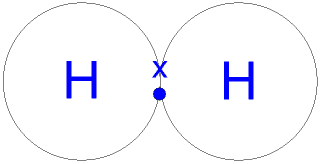
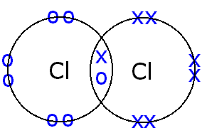
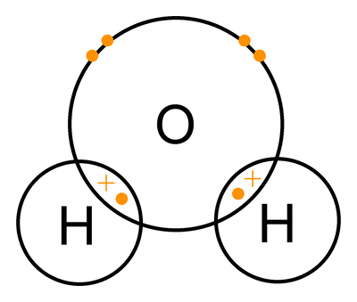
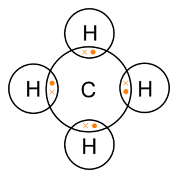
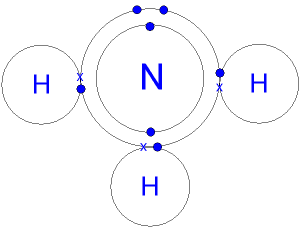
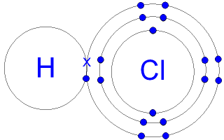

## Simple Molecules and Covalent Bonds

**Covalent Bond:** Pairs of electrons shared between two atoms leading to noble gas electronic configuration (2.8.8)

### **Covalent Bonds Dot and Cross Diagram**         

 

 

 

 

 **Different Types of Covalent Bonds**

1. Single Bonds - e.g., Chlorine
2. Double Bonds - e.g., Carbon Dioxide
3. Triple Bonds - e.g., Nitrogen

### **Properties of Covalent Compound**

1. The intermolecular forces in covalent compounds are **weak** but have **strong covalent bonds**.
2. Covalent Compounds have low melting and boiling point. They require less energy to break the weak intermolecular forces (same as attractive forces).
3. Poor Electrical Conductivity - **No free electrons or ions present** to carry an electrical current

