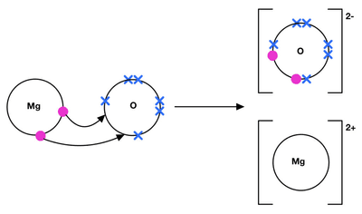
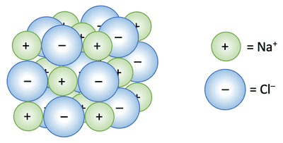

## Ions and Ionic Bonds

**Cations**: Positive Ions

**Anions**: Negative Ions

**Ionic Bonds**: strong electrostatic attraction between oppositely charged ions (metals + non-metals)

### **Ionic Compounds Dot and Cross Diagram**

Typical ionic compounds are usually **giant lattice structures** with a **regular arrangement of alternating positive and negative ions.**

* Using an X and a dot in your drawings will help differentiate the two ions.

### **Properties of Ionic Compound**

1. High Boiling and Melting Point: A lot of energy is needed to overcome the strong electrostatic forces between oppositely charged ions
2. Good Electrical Conductivity when **molten or aqueous**:
   * As the charges flow, ions can move freely in an aqueous/molten state.
   * In the solid state, ions are fixed in a giant ionic lattice, so they cannot move and charges cannot flow.

### **Other Properties of Ionic Compound**

1. Brittle
2. Low Volatility