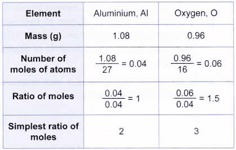

# Stoichiometry

## Formulae

**Charges of Common Ions**

|**Name**|**Formula**|**Charges**|
|:---|:---|:---|
|Ammonium|NH4+|+1|
|Nitrate|NO3-|-1|
|Hydroxide|OH-|-1|
|Carbonate|CO32-|-2|
|Sulfate|SO42-|-2|

**Molecular Formula**: The number and type of different atoms in one molecule

**Empirical Formula**: The simplest whole number ratio of the different atoms or ions in a compound.

**Molecular Formula to Empirical Formula Calculation**

$$
\text{Molecular Formula} =n (\text{Empirical Formula})
$$

$$

n=\frac{\text{Molar Mass}} {\text{Calculated Empirical Formula Mass}}
$$

* The formula of a simple and ionic compound from the relative numbers of atoms present in a model or a diagrammatic representation

### **State Symbols & Chemical Equations**

**Balancing equations:** A chemical equation is balanced when there are an equal number of atoms and charges on both sides of the equation

* **State symbols:**

  * (s) = solid
  * (l) = liquid
  * (g) = gas
  * (aq) = aqueous solution

* Names of compounds

  * A compound ending with **-ide** only contains two different elements

* A compound ending with **-ate** contains oxygen

### **Examples**

**Example 1: Simple reaction**

**Unbalanced equation:**

$\text{Ca} + \text{O}_2 \rightarrow \text{CaO}$

**Step 1: Count atoms on each side**

**Left:**

* Ca = 1

* O = 2

**Right:**

* Ca = 1

* O = 1

Oxygen is not balanced.

**Step 2: Balance oxygen**

Put **2** in front of CaO:

$\text{Ca} + \text{O}_2 \rightarrow 2\text{CaO}$

Now count again:

**Right:**

* Ca = 2

* O = 2

**Left:**

* Ca = 1

* O = 2

**Step 3: Balance calcium**

Put **2** in front of Ca:

$\text{2Ca} + \text{O}_2 \rightarrow 2\text{CaO}$

**Balanced equation:**

$\text{2Ca} + \text{O}_2 \rightarrow 2\text{CaO}$

---

**Example 2: Reaction with diatomic elements**

**Unbalanced equation:**

$\text{H}_2 + \text{Cl}_2 \rightarrow \text{HCl}$

**Step 1: Count atoms**

**Left:**

* H = 2

* Cl = 2

**Right:**

* H = 1

* Cl = 1

**Step 2: Balance hydrogen and chlorine**

Put **2** in front of HCl:

$\text{H}_2 + \text{Cl}_2 \rightarrow 2\text{HCl}$

**Balanced equation:**

$\text{H}_2 + \text{Cl}_2 \rightarrow 2\text{HCl}$

---

**Example 3: Combustion reaction**

**Unbalanced equation:**

$\text{CH}_4 + \text{O}_2 \rightarrow \text{CO}_2 + \text{H}_2\text{O}$

**Step 1: Count atoms**

**Left:**

* C = 1

* H = 4

* O = 2

**Right:**

* C = 1

* H = 2

* O = 3

**Step 2: Balance hydrogen**

Put **2** in front of H₂O:

$\text{CH}_4 + \text{O}_2 \rightarrow \text{CO}_2 + 2\text{H}_2\text{O}$

**Step 3: Balance oxygen**

**Right:**

Put **2** in front of O₂:

$\text{CH}_4 + 2\text{O}_2 \rightarrow \text{CO}_2 + 2\text{H}_2\text{O}$

**Balanced equation:**

$\text{CH}_4 + 2\text{O}_2 \rightarrow \text{CO}_2 + 2\text{H}_2\text{O}$

---

**Example 4: Ionic compound formation**

**Unbalanced equation:**

$\text{Al} + \text{O}_2 \rightarrow \text{Al}_2\text{O}_3$

**Step 1: Count atoms**

* **Left:**

  Al = 1

  O = 2

* **Right:**

  Al = 2

  O = 3

**Step 2: Balance aluminium and oxygen**

Al₂O₃ has **2** Al, so put **2** in front of Al

$2\text{Al} + \text{O}_2 \rightarrow \text{Al}_2\text{O}_3$

Al₂O₃ has **3 O**, O₂ has **2 O**

LCM of 2 and 3 = **6**

Put:

* **3** in front of O₂

* **2** in front of Al₂O₃

$2\text{Al} + 3\text{O}_2 \rightarrow 2\text{Al}_2\text{O}_3$

**Step 3: Balance aluminium again**

**4** Al on the right , so put **4** in front of Al on the left

$4\text{Al} + 3\text{O}_2 \rightarrow 2\text{Al}_2\text{O}_3$

**Balanced equation:**

$4\text{Al} + 3\text{O}_2 \rightarrow 2\text{Al}_2\text{O}_3$

---

**Example 5: Acid + metal reaction**

**Unbalanced equation:**

$\text{Zn} + \text{HCl} \rightarrow \text{ZnCl}_2 + \text{H}_2$

**Step 1: Count atoms**

Left:

* Zn = 1

* H = 1

* Cl = 1

Right:

* Zn = 1

* H = 2

* Cl = 2

**Step 2: Balance H and Cl**

Put **2** in front of HCl:

$\text{Zn} + 2\text{HCl} \rightarrow \text{ZnCl}_2 + \text{H}_2$

**Balanced equation:**

$\text{Zn} + 2\text{HCl} \rightarrow \text{ZnCl}_2 + \text{H}_2$