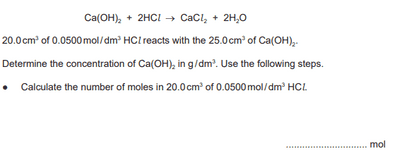

## Moles Calculation in Acid-Base Titration

 

**We will use the formula:**

$\text{Number}\ \text{of Moles} = \ \frac{\text{Concentration}\ \text{X}\ \text{Volume}}{\text{1000}\ \text{(change unit)}} $

20 x 0.0500 divide 1000 = 0.001