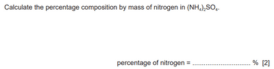

## Percentage Composition by Mass

* $\text{Percentage}\ \text{Composition by Mass} = \ \frac{\text{Mass}\ \text{of}\ \text{Element}}{\text{Molecular}\ \text{Mass}} \times 100$

**Example Question (0620/42/F/M/23)**

Step 1: Calculate the molar mass of (NH4)2SO4

Step 2: Find the mass of Nitrogen.

Step 3: Use the formula and multiply by 100.

Step 4: That will be the percentage of the question given.