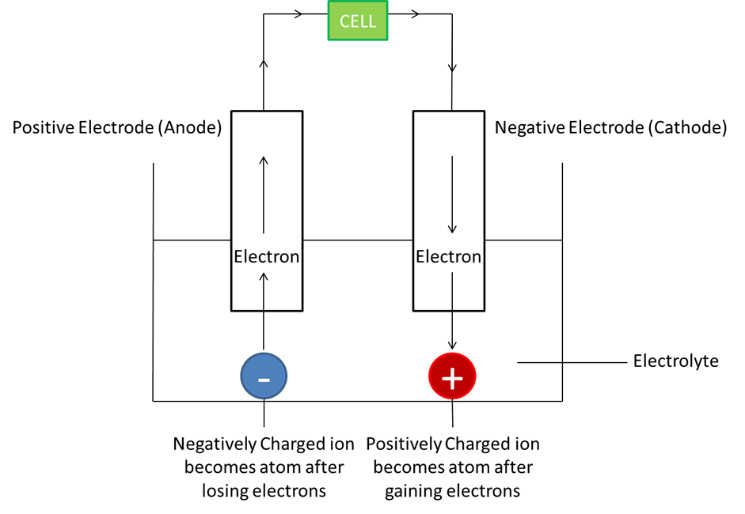

# Electrochemistry

## Electrolysis

**Electrolysis:** the decomposition of an ionic compound, when molten or aqueous solution- by passing of an electric current

* This is possible due to the presence of **mobile electrons/free-moving ions**
* An **electrolyte** is a **molten or aqueous substance that undergoes electrolysis**

| Components of Electrolysis | Definition |
|----|----|
| Electrodes | Metal or graphite rods that aid the flow of electricity in and out of the electrolyte   1. Anode: Positive electrode   2. Cathode: Negative Electrode (**PANIC**: Positive is Anode, Negative is Cathode) |
| Anion | Negatively charged ion that moves to anode |
| Cation | Positively charged ion that moves to the cathode |

* Note: **Reactive** electrodes participate in the reaction, while **inert** electrodes (Graphite, Carbon) do not react with the cations or anions.

