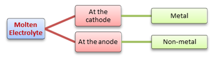
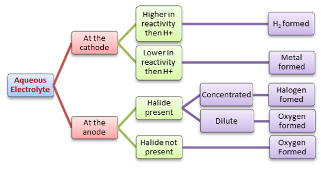

## Reduction and Oxidation

* **Reduction** of positive cations happens at the cathode
* **Oxidation** of negative anions happens at the anode

  **For example** (Ionic Half Equations)
  * At the anode: 2Cl- → Cl2 + 2e-
  * At the cathode: 2H+ + 2e- → H2

 

 

### **Useful Acronyms**

1. **REDCATANOX** (Reduction is Cathode, Anode is Oxidation)
2. **OILRIG** (Oxidation is loss, Reduction is gain)
3. **PANIC** (Positive is Anode, Negative is cathode)
4. **CMAN** (Cathode discharge Metals, Anode Discharge Non-Metals)

