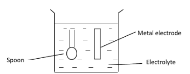

## Electroplating

**Electroplating:** the process of coating the surface of a metal (more reactive) with another metal (less reactive) using electrolysis

* **Components:**
  * Anode: pure/impure metal being used for electroplating the object
  * Cathode: object being electroplated
  * Electrolyte: aqueous solution of the soluble salt of pure metal (same as anode)
* **Used to:**
  * Prevent corrosion
  * Enhance appearance

’

* Cathode (–): Object to be electroplated (e.g. spoon)

* Anode (+): Pure/impure metal electrode

* Electrolyte: Aqueous solution of the salt of the metal