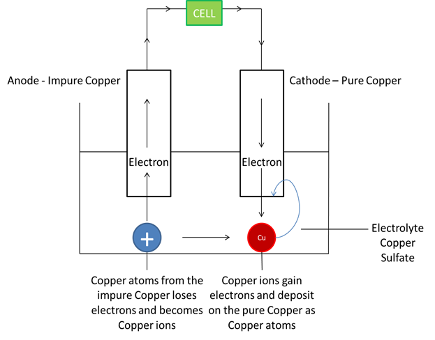

## Refining Metals

* Cathode: a thin strip of pure metal
* Anode: impure metal
* Electrolyte: Aqueous Salt Solution of metal

**Example:**

* **The refining of copper:** Impure copper as the anode and pure copper as the cathode; the aqueous copper (II) sulfate helps the copper ions move from the anode to the cathode. Here, the ions gain electrons and become copper atoms, making the pure copper cathode thicker.

  
  1. Reaction at Anode: Cu → 2e + Cu2+ (mass decreases)
  2. Reaction at Cathode: Cu2+ + 2e → Cu (mass increases)

