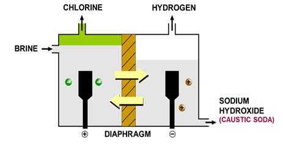

## Electrolysis of Brine

* Brine is a concentrated aqueous NaCl solution
* Ions present: Na+, H+, Cl- and
  OH-

| **At the anode** | **At the cathode** |
|----|----|
| Made of titanium | Made of steel |
| Cl- ions; Chlorine gas | Hydrogen cations reduced to H2 molecules |

| Unreacted ions (Na+, H+ and OH-) move through porous membranes due to differences in liquid pressure |
|----|
| Left Na+ and OH- which form aqueous sodium hydroxide |

