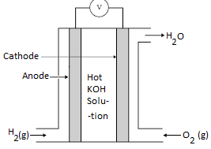

## Hydrogen-Oxygen Fuel Cells

**Hydrogen-Oxygen Fuel Cells**: Uses **hydrogen and oxygen as the main reactants** to produce electricity; the only product released is **water**.

* At anode (left): H₂(g) in

* At cathode (right): O₂(g) in

* Product: H₂O(l)

**Main Chemical Equation**: 2H2 + O2 → 2H2O

|Advantages of motor vehicles|Disadvantages of motor vehicles|
|:---|:---|
|Renewable source|Large fuel tank required|
|Emission Free (No carbon pollutions)|Currently expensive|
|Non-toxic|Lesser Hydrogen Filling stations|
