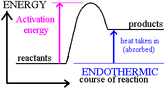
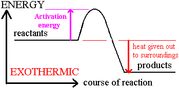

## Energy Level Diagrams

* Energy level diagrams represent chemical reactions that include the relative energies of the reactant and product.
* A reaction's energy change (∆H) is represented by the difference in height between the reactant and its product.
* The activation energy (Ea) is the minimum energy required for the reaction to take place.

### **Endothermic Energy Level Diagram**

* The system gains energy; higher activation energy is required: Energy is taken in. 

### **Exothermic Energy Level Diagram**

* The system loses energy; lower activation energy is required: Energy is given out.

