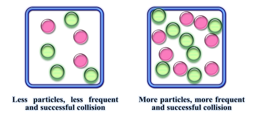

## Concentration

Increasing the concentration of reactants increases the rate of reaction

* Higher-concentration reactants contain more particles per unit volume, increasing the successful collision and reaction rates.
* Increasing concentration increases the number of particles per unit volume, leading to more frequent collisions and a faster reaction rate (activation energy unchanged).

