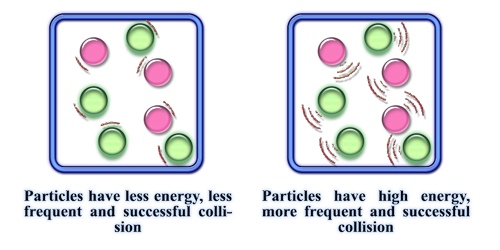

## Temperature

Increasing temperature increases the **rate of reaction**

* Increasing temperature gives particles more kinetic energy. A greater proportion of reactant particles have energy ≥ activation energy, leading to more frequent successful collisions and a faster reaction rate.
* In a reversible reaction, increase in temperature increases the rate of reaction for both the forward and backward reaction.

