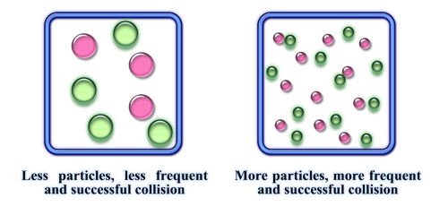

## Surface Area of Solids

Decreasing the particle size increases the rate of reaction

* Decreasing particle size increases surface area; more reactant particles are exposed to collide, so the successful collision rate increases. This results in an increased rate of reaction

 **Explosive Combustion**

* Fine particles are combustible in the air due to a larger surface area
* The rate of reaction is high, making them explosive
* Examples: methane gas in coal mines and flour milling

