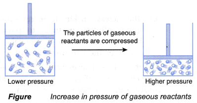

## Pressure

Increasing the pressure in a gaseous system increases the rate of reaction

* The distance between particles is reduced under pressure
* There are more particles per unit volume; the successful collision rate increases, resulting in an increased reaction rate.

 