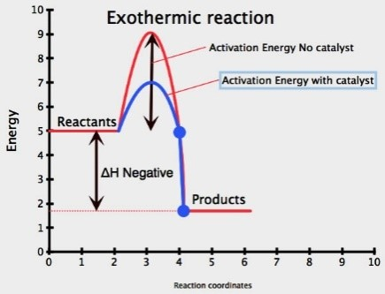

## Catalyst

A catalyst is a substance that increases the reaction rate **by lowering the activation energy and is left unchanged at the end of the reaction.**

* More particles will have an energy greater than or equal to the activation energy, therefore successful collision rate increases, resulting in an increased rate of reaction
* For gaseous reactants, if the catalyst is solid metal, the catalyst provides a surface for the reaction.
* The larger the surface area of the metal catalyst, the larger the area for the reaction to take place; therefore higher the rate of reaction

### **Enzymes Affecting Rate of Reaction**

* Enzymes are biological catalysts that speed up reactions but remain chemically unchanged.
* Enzymes function best at optimum temperature and pH level; otherwise, they may denature and completely stop functioning.

