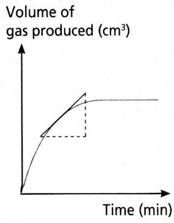
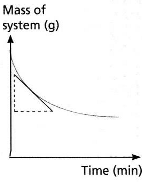
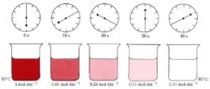

## Rates of Reaction Graphs

**Interpreting graphs:**

A graph with a steeper gradient at the beginning and reaching a horizontal gradient faster depicts a high rate of reaction.

| **Gas Evolved** | **Mass Loss** | **Colour Change** |
|----|----|----|
|   |   |   |
| If a gas evolves, measure the volume of gas produced per unit of time using a gas syringe | If a gas evolves, measure the loss in mass per unit time by placing it on a balance and then putting cotton wool on top to allow gas to pass but not enter | If a colour change, measure the time taken to turn cloudy |

