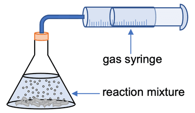
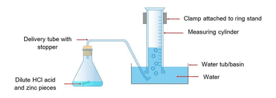

## Evaluating Practical Methods

1. **Change in Mass method**
   * Not suitable for experiments where hydrogen gas is given off (because density decreases, too small mass)
2. Easier to set up the **gas syringe** and obtain reliable measurements  
3. **An inverted Measuring cylinder** to collect gas over water is harder to set up.  

