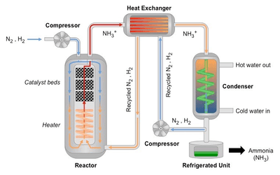

## Haber Process

### **N2 + 3H2 ⇌ 2NH3 (g) [Exothermic]**

**Materials (Reactants) in the Haber Process**

Nitrogen: From the **air.**

Hydrogen: From the reaction between **Methane** **and Steam**          

### **Conditions**

Temperature: **450°C**

Pressure: **200 atm (20,000 kPa)**

Catalyst: **Iron catalyst**

**Why are these conditions chosen in the Haber Process?**

1. **Pressure is not extremely high** - (Although increased pressure is more yield, more pressure will require more expensive equipment, and it can explode).
2. **Optimum temperature** - (If lower temperature, more ammonia yield, however too low, the rate is uneconomical.