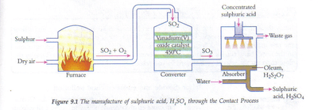

## Contact Process

### **2SO2 + O2 ⇌ 2SO3 (g)  \[Exothermic\]**

**Materials (Reactants) in Contact Process**

Sulfur Dioxide: **Burning sulfur or Roasting Sulfide ores**

Oxygen: From the air

 

### **Conditions**

Temperature: **450°C**

Pressure: **2 atm (200 kPa)**

Catalyst: **Vanadium (V) oxide catalyst**

**Why are these conditions chosen in the Contact Process?**

1. **Pressure is high** - (Increase pressure, more yield)
2. **Optimum temperature** - (If lower temperature, more sulfuric acid yield, however too low, the rate is uneconomical.

