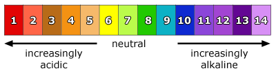

## Neutral

* Neutral substances have a pH value of 7.

* **pH scale**

  pH is the concentration of H+ ions per dm3 of solution

  **Universal indicator** solution is used to determine the pH of a substance by matching the color change to the pH color chart.

