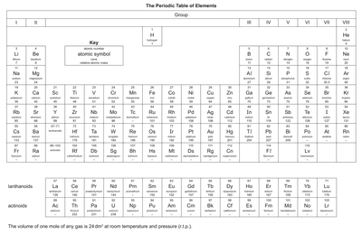

# The Periodic Table

## Arrangement of Elements

* The Periodic table is a method of classifying elements.
* Elements are arranged in order of increasing atomic number (each proceeding element has one more proton)
* Made up of rows called periods and columns called **groups**, the position of an element helps determine its electronic configuration.
* **Period number**: number of electron shells
* **Group number**: number of outer shell electrons

Elements in the same group have similar chemical properties.       

### **Periodic Trends**

1. The table moves from metals on the left to non-metals on the right.
2. Down a group of metals, elements become more reactive.
3. With non-metals going down a group, reactivity decreases.

