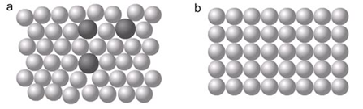

## Alloys and their Properties

**Alloy**: a mixture of two or more metals or a metal and non-metal

* Alloys are useful because they are harder and stronger/useful than pure metal; they can also resist rusting with air and water.

|**Alloy**|**Made from**|**Special Properties**|**Uses**|
|:---|:---|:---|:---|
|Brass|Copper and zinc|Stronger and more resistant to corrosion/rusting|Electrical fittings, car radiators|
|Stainless steel|Iron, carbon, chromium and nickel|resistant to corrosion/rusting|Kitchen sinks, cutlery, surgical instruments|

* Due to the irregularity in atom sizes and structure, metal alloys, which stop layers from sliding over each other, are stronger. 
* Alloys contain metals cations of different sizes, the large cations block the layer of small metal cations.
* This is what the structure of an alloy (a) looks like compared to a pure metal (b).

