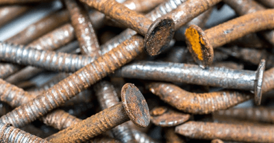
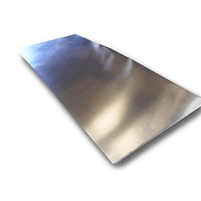

## Corrosion of Metals

**Rusting:** the corrosion of iron and steel to form rust (**hydrated iron (Ill) oxide**) via oxidation

 **The conditions for rusting to occur:**

1. Water
2. Air containing oxygen

### **The Equation for Rusting of Iron**

| Iron + Water + Oxygen  →  Hydrated Iron (Ill) Oxide |
|----|
| 4Fe (s) + 2H2O (l) + 3O2 (g)  →  2Fe2O3·H2O (s) |

### **Two Ways of Preventing Rust**

1. **Barrier Method**
   * Coating a material to prevent the iron/steel from being in contact with water and oxygen (Painting, Greasing & Plastic Coating)
2. **Sacrificial Method**
   * When more reactive metals corrode to less reactive metals, they lose electrons in preference to iron.

### **Galvanisation of Iron**

It is the **protection of iron and steel objects** by coating them with a **layer of zinc.**           

**The barrier method** is due to the zinc layer preventing exposure to air and water and sacrificial protection due to zinc being more reactive than iron, corroding in preference to iron.