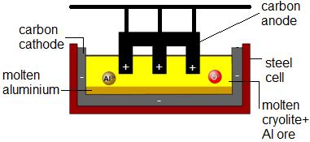

## Extraction of Aluminium

* The main ore of Aluminium Oxide is bauxite
* Aluminum (III) oxide (alumina) is dissolved in molten **cryolite** ($Na_{3}AlF_{6}$**) – this mixture has a lower melting point (industrially preferred)**    

During electrolysis, aluminium ( Al3+ + 3e-  → Al ) is produced at the carbon cathode, and oxygen (2O2- → O2 + 4e-) at the carbon anode.

### **Molten Cryolite**

* High temperatures are needed to melt, which is expensive. Therefore, molten cryolite **lowers the melting point/operating temperature and increases conductivity.**
* Due to the high temperature, the oxygen **reacts with the carbon** in the graphite anode to form CO2, so the anode must **be periodically replaced.**