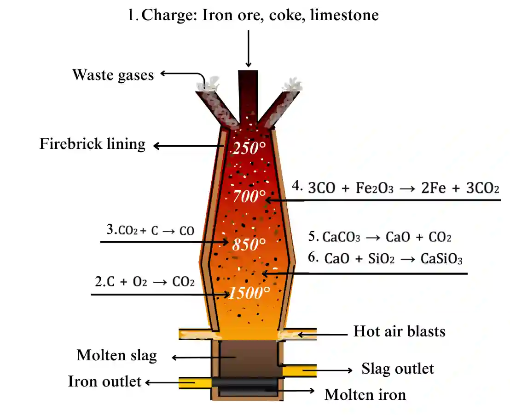

## Extraction of Iron

* The Ore of Iron is hematite (**Fe2O3**) + Impurities
* Burning of coke (Carbon) to **provide heat and produce carbon dioxide**

1. Ore is crushed and mixed with carbon and limestone (**CaCO3**) and transferred into the blast furnace

|**C + O2 → CO2 (exothermic)**|
|:---|
|**CaCO3  → CaO + CO2 (thermal decomposition)**|
|**CO2 +  C  →  2CO**|

2. Carbon monoxide reduces Iron(III) oxide from the ore to iron

   **Fe2O3 + 3CO  → 2Fe + 3CO2**

3. The Calcium oxide reacts with impurities like silica to form slag (a waste product) - Neutralization reaction

   **CaO +  SiO2→ CaSiO3**

4. Uses of slag include making roads and cement

   

The remaining waste gases that leave the blast furnace are **Carbon Dioxide, Carbon Monoxide, and Nitrogen.**