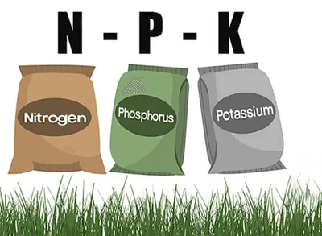

## Fertilisers

**Fertilisers**: Substances added to the soil and taken up by plants to increase crop yield.

Fertilisers contain substances such as **nitrates** and **ammonium salts**.      

**N.P.K** - Nitrogen, Phosphorus, and Potassium Fertilisers are found inside fertilisers, essential to **improve plant growth.**

### **Functions of Elements**

1. Nitrogen - Makes chlorophyll and protein. Promotes healthy leaves
2. Phosphorus - Promotes healthy roots
3. Potassium - Promotes growth and healthy fruits and flowers

Reaction with any alkali substance (except ammonia) displaces ammonia from its compound, for example:

**Calcium hydroxide + Ammonium chloride → Calcium chloride + Ammonia + Water**