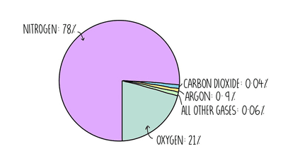
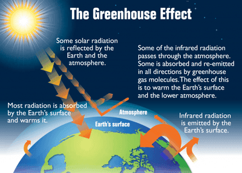

## Air Quality and Climate

The pie chart below presents the components present in clean air:

* Primary: **Nitrogen (78%), Oxygen (21%)**
* Secondary: **Noble gases (mainly Argon) and Carbon Dioxide (1%)**        

### **Air Pollutants and their Adverse Effects**

| **Pollutant** | **Source** | **Negative impact** |
|----|----|----|
| Carbon monoxide (CO) | Incomplete combustion of carbon-containing fuels (ex. Internal combustion engines) | Binds with haemoglobin, constricting oxygen supply in cells; leads to fatigue/ death |
| Carbon Dioxide (CO2) | Complete Combustion of Carbon Containing Fuels | Increased global warming leads to climate change. |
| Methane (CH4) | Decomposition of vegetation and waste gases from digestion in animals | Increased global warming leads to climate change. |
| Sulfur Dioxide (SO2) | Combustion of fossil fuels which contain sulfur compounds | It causes acid rain. |
| Nitrogen Oxides  (NO2) | High temperatures that trigger a reaction between N2 and O2 (from air) | Causes respiratory problems and photochemical smog; contributes to acid rain |
| Lead Compounds | Combustion of leaded fuels | Damages brain and nerve cells in young children |

### **Impact of Greenhouse Gases**

1. **Short wavelength radiation** from the Sun reaches the Earth's surface
2. Some thermal energy is **absorbed and heats oceans/lands**
3. Earth radiates some thermal energy **as more prolonged wavelength radiation**
4. Greenhouse gases absorb some of the infrared radiation and **re-emit in all directions**
5. Some infrared radiation comes back to Earth's surface, and this reduces the heat loss to space and leads to global warming       

### **Strategies to Reduce the Effect of Environmental Issues**

1. **Climate Change**: planting trees, reducing livestock farming, decreasing the use of fossil fuels, increasing the use of hydrogen and renewable energy, e.g. wind, solar
2. **Acid Rain**: use of catalytic converters in vehicles, reducing emissions of sulfur dioxide by using low-sulfur fuels and flue gas desulfurisation with calcium oxide

### **Photosynthesis**

**Photosynthesis:** the reaction between carbon dioxide and water to produce glucose and oxygen in the presence of chlorophyll and using energy from light.

Word Equation: **Carbon Dioxide + Water → Glucose + Oxygen**

Balanced Chemical Equation:

**6CO2 + 6H2O → C6H12O6 + 6O2**