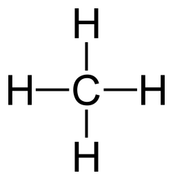
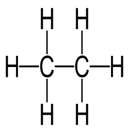
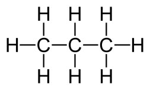
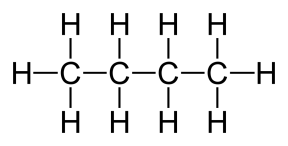

## Alkanes

**Alkanes**: saturated hydrocarbons \[single carbon bonds\] that are generally unreactive; however, they do undergo combustion reactions

**General formula = CnH2n+2**

| Methane: CH4 (n=1) | Ethane: C2H6  (n=2) |
|----|----|
|  |  |
| **Propane: C3H8 (n=3)** | **Butane: C4H10 (n=4)** |
|  |  |

### **Substitution Reaction**

Alkanes go through substitutional reactions, where the atom of another element under UV light replaces the hydrogen atom. (Photochemical)

* The presence of UV light is to **provide activation energy**

CH4 + Cl2 → (light) → HCl + CH3Cl / CH2Cl2 / CHCl3 / CCl4

Compounds = chloromethane/di/tri/tetrachloromethane