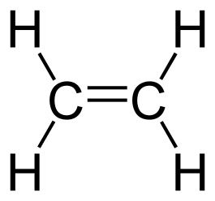
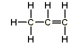
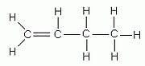
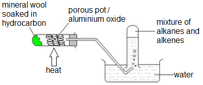

## Alkenes

**Alkenes**: unsaturated hydrocarbons [at least one double bond between 2 carbon atoms]

Have isomers: same molecular formula but different structural formula (placement of double bond shifts), e.g. but-1-ene and but-2-ene

**General formula = CnH2n**

**Functional group: C=C bond**

|**(n=1)**|**Ethene:C2H4 (n=2)**|
|:---|:---|
|**N/A**||
|**Propene:C3H6 (n=3)**|**But-1-ene:C4H8 (n=4)**|
|||

---

### **Catalytic Cracking (Alkane)**

* Thermal decomposition reaction at 700 Celsius, in which an alkene (and sometimes hydrogen) is produced from an alkane. It also form shorter-chain alkanes. 

* Hydrocarbon is heated, and vapours are passed over a catalyst (alumina (Al2O3 and silica)

* **Cracking** always produces a short-chain compound with a C=C bond **(matches the supply of fractions with demand and produces alkene for feedstock.)**

  e.g. Cracking of ethane will give ethene and hydrogen

* Butane → Ethane + Ethene ; **C4H10** **→
  C2H6** **+ C2H4**

**How do we distinguish between saturated and unsaturated hydrocarbons?**

Using Bromine water (reddish-brown):

* Saturated: remains reddish brown (unreactive)
* Unsaturated: turns colourless/decolourises