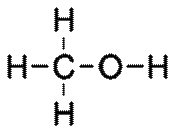

## Alcohols

**General formula = $\mathrm{C_nH_{2n+1}OH}$**

**Functional group: OH**

|**Methanol: $\mathrm{CH_3OH}$ (n=1)**|**Ethanol: $\mathrm{C_2H_5OH}$ (n=2)**|
|:---|:---|
|||
|**Propanol: $\mathrm{C_3H_7OH}$  (n=3)**|**Butanol: $\mathrm{C_4H_9OH}$ (n=4)**|
|||

## Methods of Production

|Fermentation of Aqueous Glucose (for Ethanol)|Catalytic Addition of Steam to Ethene|
|:---|:---|
|Yeast is added to dissolved glucose. The products ethanol, carbon dioxide, and the temperature between 25-35 °C are used for optimal enzyme activity.|The ethene reacts with steam (reversibly) to form ethanol in the following conditions: **300°C,  60 atm (6000 kPa).** Catalyst - phosphoric acid \[while low temp gives better yield, high temp is used for a faster rate of reaction\]|
|The slow reaction produces a dilute solution that requires processing. Can only be produced in batches|The fast reaction produces pure ethanol. Continuous production (no batches)|
|Produces greenhouse gas ($CO_2$)|No greenhouse pollutants|
|Uses renewable resources|Uses non-renewable resources (crude oil)|

**Uses of Ethanol:**

* Solvent in glues, printing inks & perfumes
* Fuel