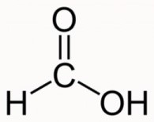

## Carboxylic Acids

**General formula**: $C_nH_{2n+1}COOH$

**Functional group**: COOH

|**Methanoic Acid:  (n=0) $CH_2O_2$**|**Ethanoic Acid:  (n=1) $CH_3COOH$**|
|:---|:---|
|||
|**Propanoic Acid:  (n=2) $C_3H_6O_2$**|**Butanoic acid:  (n=3) $C_4H_8O_2$**|
|||

### **Properties of Ethanoic Acid**

* Weak acid with high pH and low dissociation
* Formed by:
  * Bacterial Oxidation of Ethanol (Vinegar Production)
  * With acidified aqueous potassium manganate (VII) (Good Oxidising Agent)

Carboxylic acids react with alcohols (with an acid catalyst/Heat) to give esters in a **condensation reaction**, for example:

* Ethanoic acid \+ ethanol ⇌ ethyl ethanoate \+ water (alcohol = -yl & carboxylic acid = -anoate)

* Carboxylic Acids also have **different structural isomers.**

### **Reactions with Carboxylic Acid**

* Magnesium reacts with ethanoic acid to form magnesium ethanoate and hydrogen gas.
  * $2CH_3COOH+Mg→CH_3COO_2Mg+H_2$
* When propanoic acid reacts with hydroxides, it will form salt and water (Neutralisation reaction)
  * $CH_3CH_2COOH$ \+$KOH$ **→** $CH_3CH_2COOK$ \+ $H_2O$
* When butanoic acid reacts with carbonates, it will form salt, water, and carbon dioxide.
  * $2CH_3CH_2CH_2COOH$ \+ $Na_2CO_3$ **→** $2CH_3CH_2CH_2COONa$ \+ $H_2O$ \+ $CO_2$