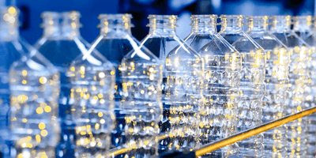

## Polymers

* Large molecules are built up from small units known as monomers.
* Monomers are **a single unit of a substance.**

* Polymers can have different linkages depending on the type of polymerisation and monomer

**Example:**

| **Small units (monomers)** | **Linkages** |
|----|----|
| Polyester (PET) | Ester |
| Polyamide & Protein | Amide |

<table> <thead> <tr class="header"> <th></th> <th><strong>Use</strong></th> <th><strong>Structure</strong></th> </tr> </thead> <tbody> <tr class="odd"> <td> 
<strong>Poly(ethene)</strong>
 </td> <td>Plastic bags and gloves, clingfilm (low density), mugs, bowls, chairs, dustbins (high density)</td> <td></td> </tr>

## Plastics (PET)

Plastics (**polyethylene terephthalate)** are made from polymers. However, they are not biodegradable. (NOTE: PET can be hydrolysed back to monomers and re-polymerised)      

### **Environment Challenges caused by Plastics**

1. Disposal in Landfill sites
2. Accumulation in Oceans
3. Formations of toxic gases from burning

