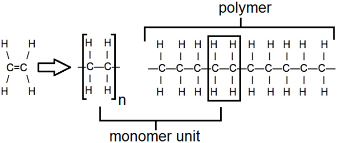
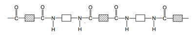
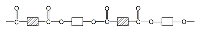

## Addition and Condensation Polymerisation

### **Addition Polymerisation**

* This only occurs in monomers that contain double carbon (**C=C)** bonds.
* Polymers produced using alkene monomers
* Forms only a polymer molecule
* Poly(ethene): is a polymer produced from ethene by addition polymerisation

Double bond splits, and the polymer is formed. (Polymers have no double bonds)

### **Condensation Polymerisation**

* When two different monomers are linked together with the removal of a smaller molecule, usually **water** (forms one H20 molecules per linkage).

  1. **Nylon** (polyamide) is made from a **dicarboxylic acid monomer and a diamine monomer** (a compound with an NH2 functional group). Forms **amide linkage.**

     

  2. **PET** (polyester) is made from a dicarboxylic acid monomer and diols (alcohol with an -OH functional group). Forms **ester linkage.**

     