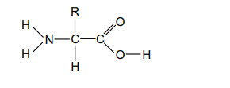
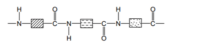

## Protein & Natural Polyamides

Proteins act as the natural polyamides formed from amino acids monomers.

**General Structure of Amino Acids:**  

**Proteins:**

* Proteins contain the same linkages (amide links) as nylon but with different units from amino acid monomers. Their main structure you should know is:     

