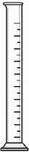
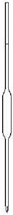
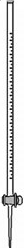
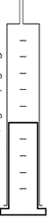

# Experimental Techniques and Chemical Analysis

## Measurement

| Variable | Unit(s) | Apparatus |
|----|----|----|
| Time | min/sec | Stopwatch |
| Temperature | ºC | Thermometer |
| Mass | grams | Balance |

### **Measuring Volume in Liquids**

Approximate measure to most accurate measure.

| **Name** | **Measuring Cylinder** | **Volumetric Pipettes (fixed volumes)** | **Burettes (variable volume)** |
|----|----|----|----|
| **Image** |   |   |   |

### **Measuring Volume in Gases**

| **A gas syringe is used to measure the volume of gases gradually** |   |
|----|----|

