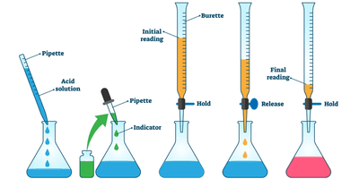

## Acid-Base Titration

**A method of quantitative chemical analysis where an acid is added slowly to a base until it has been neutralised.**     In Acid-Base Titrations, we must add a few drops of indicator (passes the endpoint) to check whether there are colour changes in the chemical reaction.

| Indicators | **Colour in Acid** | Colour in Neutral | Colour in Base |
|----|----|----|----|
| Thymolphthalein | Colourless | Colourless | Blue |
| Methyl Orange | Red | Orange | Yellow |

