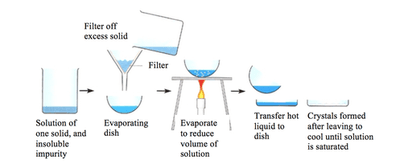

## Crystallisation

**Used to separate dissolved solid from a solution**

* The solution is heated to increase concentration (solvent evaporates)
* A drop of solution is placed on a slide to check for crystal formation
* The solution is left till it reaches the crystallisation point.
* Crystals are filtered from the solution, washed with distilled water, and dried between the filter paper.  

