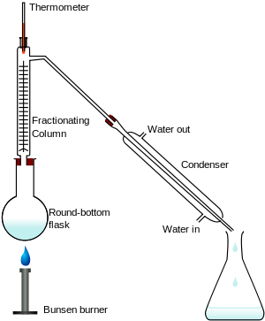

## Fractional Distillation

**Used to separate miscible liquids**

* Mixture is heated
* Substances, due to their different boiling points, rise in different fractions.
* A mixture of gases condenses on the beads in the fractional column.
* The beads are heated to the boiling point of the lowest substance so that the substance being removed cannot condense on the beads.
* The other substances continue to condense and will drip back into
  the flask.
* The beaker can be changed after every fraction

