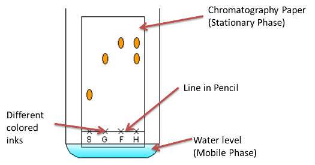

## Chromatography

**Used to separate substances in a solvent with different solubilities.**

1. Drop the substance onto the start line (pencil) drawn on chromatography paper.
2. Paper is placed in a beaker with solvent; the paper must touch the surface of the solvent (**water or ethanol**) while the line must be above the liquid.
3. The solvent travels up the paper.
4. Different solubilities lead to different travel rates (**high solubility -> high travel rate**)
   * The stationary phase is the material on which separation takes place
   * The mobile phase is the mixture you want to separate, dissolved in a solvent.

   

* Interpreting simple chromatograms:

  Chromatograms are the visual outputs on the chromatography paper
  * **Number of rings/dots = number of substances**
  * If two dots travel the same distance up the paper, they are the **same substance.**
  * The pure substance only gives **one spot.**
* Retention Value:

  Used to identify a substance, calculated by the formula:

$$
\text{Rf}\ \text{Value} = \ \frac{\text{Distance}\ \text{moved}\ \text{by}\ \text{substance}}{\text{Distance}\ \text{moved}\ \text{by}\ \text{solvent}}
$$

### **Locating Agents**

* Used to make colourless chromatograms visible
  * Dry paper in the oven
  * Spray it with locating agent
  * Heat it for 10 minutes in the oven

