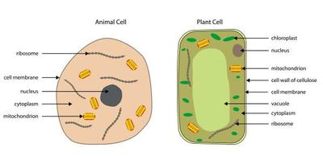
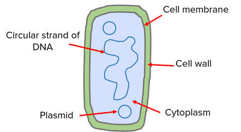

# Cells

## Cell Structure

### **Levels of Cellular Organization**

* From the smallest to more complex structures:
  * Cell → Tissue → Organ → Organ system → Organism
    * Living organisms are made of cells
* New cells are produced by the division of existing cells

### **Plant Cell and Animal Cell**

|Structure|Description|Function|Animal or Plant cell|
|:---|:---|:---|:---|
|Cell wall|Made mainly of **cellulose**|Support and stop cells from bursting|Plant|
|Cell membrane|Thin layer of protein and fat|**Partially permeable -** Control substances that enter and exit|Both|
|Nucleus|Has **chromosomes** - made of DNA|Stores genetic information & controls activities of the cell|Both|
|Cytoplasm|Clear jelly - many substances are dissolved in it|Site of **metabolic reactions**|Both|
|Chloroplasts|Contains **chlorophyll**|Absorb light energy (for photosynthesis)|Plant|
|Ribosomes|Scattered tiny structures|Site of **protein synthesis**|Both|
|Mitochondria|*‘Powerhouse’* of the cell|Generate chemical energy through **respiration**|Both|
|Vacuoles|**Permanent** large space surrounded by a membrane, containing cell sap|Keep cells firm|Plant (known as *vesicles* in animal cells)|

### **Bacterial Cell**

|Structure|Description|Function|
|:---|:---|:---|
|Cell wall|Made from **peptidoglycan**|Protection and helps maintain shape|
|Cell membrane|Partially permeable|Maintains constant state|
|Cytoplasm|Clear jelly - many substances are dissolved in it|Site of **metabolic reactions**|
|Ribosomes|Scattered tiny structures|Site of protein synthesis|
|Circular DNA|Bacterial chromosomes contained in the nucleoid|Contains genetic information|
|Plasmids|Small, circular molecules of DNA|Extra genes - giving them a selective advantage|

### **Specialised Cells**

|Cell|**Specfic** Functions|
|:---|:---|
|Ciliated cells|Movement of mucus in the trachea and bronchi|
|Root hair cells|Absorption|
|Palisade mesophyll cells|Photosynthesis|
|Neurones|Conduction of electrical impulses|
|Sperm and egg cells (gametes)|Reproduction|
|Red blood cells|Transport of oxygen|
