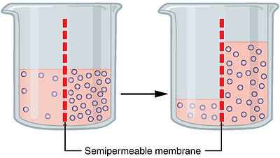

## Osmosis

* Water diffuses through partially permeable membranes **by osmosis**

* The net movement of water molecules from a region of higher water potential → a region of lower water potential

* Through a partially permeable membrane

  

* ***Water moves*** into and out of cells by osmosis through the **cell membrane**

* Effect on **plant cells** when immersing **PLANT TISSUES** in solutions of different concentrations:

  * **Dilute solution** (high water potential)
    * Water moves into the cell - due to higher water potential **in the solution**
    * The cytoplasm and vacuole swell
    * The cell becomes **turgid** (tight and firm)
    * The outward pressure of the cytoplasm on the cell wall is called the **turgor pressure.**
  * **Concentrated solution** (low water potential)
    * Water moves out of the cell - due to higher water potential in the cell
    * The cytoplasm and vacuole shrink
    * The cell becomes **flaccid** (the plant begins to wilt)
    * **Plasmolysis:** when the cell membrane pulls away from the cell wall because a lot of water moves out of the cell

* **Importance of water potential and osmosis:**

  * **Osmosis:**
    * Responsible for the uptake of water in plants
  * **Water potential:**
    * Loss of water through **transpiration** in plants (due to the water potential difference)