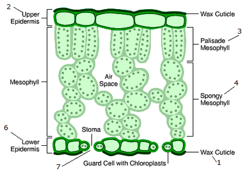

## **Leaf Structure**

### **Features**

* Leaves have a **large surface area**:
  * Maximise exposure of the leaf to sunlight and air 
* Leaves are **thin:**
  * Allow sunlight to penetrate to all cells
  * Allow CO2 to diffuse in and O2 to diffuse out quickly 

### **Structures**

 

1. **Chloroplasts:**
    * Arranged broadside on -> maximise absorption of sunlight 
2. **Cuticle:**
    * A waxy substance to stop water evaporating from the leaf 
3. **Guard cells and stomata:**
    * Guard cells (**do contain chloroplasts**) - control the opening of the stomata 
    * Stomata - to allow CO2 to diffuse in and O2 to diffuse out 
4. **Upper and lower epidermis:**
    * Epidermal cells are transparent, with no chloroplasts -> sunlight can reach the mesophyll cells
5. **Palisade mesophyll:**
    * Palisade cells arrange end on -> maximise absorption of sunlight
    * Palisade cells are tightly packed ->  maximise absorption of sunlight
6. **Spongy mesophyll:**
    * There are air spaces in the spongy mesophyll 
7. **Air spaces:**
    * To allow CO2 to diffuse to all cells 
8. **Vascular bundles (xylem and phloem):**
    * Xylem vessels supply water (from the roots) to cells in the leaf
    * Phloem tubes take away sucrose and other organic products of photosynthesis to other parts of the plant
