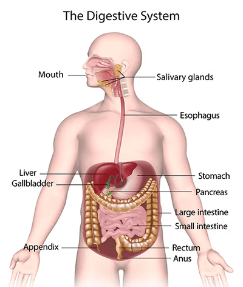

## Digestive System

### **Digestion Process**

* **Ingestion –** the taking of substances, e.g. food and drink, into the body
* **Digestion –** the breakdown of food
* **Absorption –** the movement of nutrients from the intestines into the blood
* **Assimilation –** uptake and use of nutrients by cells
* **Egestion –** the removal of undigested food from the body as faeces

### **Main Organs of the Digestive System:**

 

* **Mouth:** Helps with ingestion and contains teeth for mechanical digestion
* **Salivary glands:** Secretes saliva
  * Contains water, mucus, and the enzyme amylase
* **Oesophagus:** Food passes from the mouth to the stomach here by **peristalsis**
* **Stomach:** Helps with mechanical and chemical digestion
  * **Mechanical digestion:** Muscles contract and relax to mix food with enzymes and mucus
  * **Chemical digestion:** Contains the protease enzyme pepsin, which breaks down protein into polypeptides
* **Pancreas:** Secretes pancreatic juice, which contains amylase, lipase, and protease
* **Liver:** Produces bile
* **Gallbladder:** Stores bile
* **Small intestine**
  * **Duodenum:**
    * The first part of the small intestine, digestion, happens here
    * Chyme (acidic mixture of food and gastric juices), pancreatic juices, and bile enter
  * **Ileum:**
    * The second part of the small intestine, absorption and assimilation, happens here.
    * The inner wall is covered with villi
* **Large intestine**
  * **Colon:** Water and salts are absorbed from waste
  * **Rectum:** The end of the large intestine, contains faeces
* **Anus:** Egestion takes place here, controls when faeces is released

