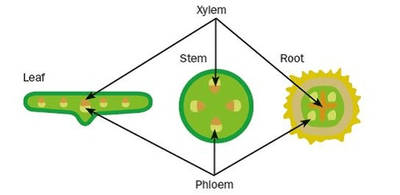

# Transport in Plants

## Xylem and Phloem

* Xylem – transport of water and mineral ions and support
* Phloem – transport of sucrose and amino acids

### **Position of Xylem and Phloem**

 

* *Remember:* the xylem is always on the inside, and the phloem is always on the outside.

