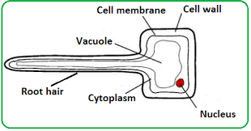
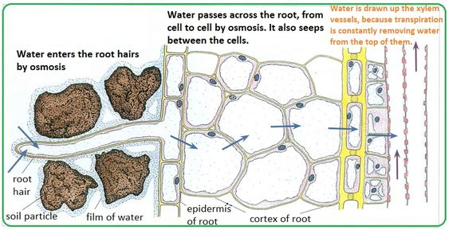

## Water Uptake

* **Function of the root hair cells** -  **Absorption** of water and mineral ions
  * The large surface area of root hairs increases the uptake of water and mineral ions   

### **Pathway Taken by Water**

1. Root hair cells
2. Root cortex cells
3. Xylem
4. Mesophyll cells

