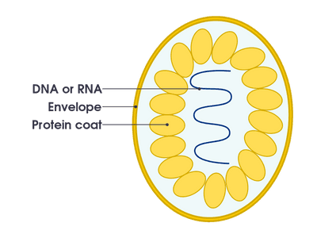

# Diseases and Immunity

## Diseases

* A pathogen is a disease-causing organism
* **Transmissible disease:** a disease in which the pathogen can be passed from one host to another
  * By direct contact *(through blood and other bodily fluids)*
  * Indirectly *(from contaminated surfaces, food, animals and air)*
* Virus is a type of pathogen    

| **Feature** | **Description** |
|----|----|
| Protein coat (capsid) | Protects the genetic material |
| Genetic material | It can either be DNA or RNA |

* Body defenses against pathogen: 

| Feature | Description | 
| -------- | -------- |
| Skin     |  Prevents pathogens from entering the body   |
| Hairs in the nose    | Traps microorganisms -> protect the lungs from **infection** |
| Mucus     | Traps microorganisms -> protect the lungs from **inflammation** and **infection** |
| Stomach acid     | Kills harmful microorganisms in food, preventing infection by pathogens    |
| White blood cells   | Engulfs pathogen and produce antibodies    |

### Controlling the Spread of Disease
* **Clean water supply:**
  * Contaminated water contains harmful microorganisms and can enter our body through our mouth, eyes, nose, etc
* **Hygienic food preparation:**
* **Good personal hygiene:**
* **Waste disposal:**
  * Improperly managed waste can serve as a breeding ground for pathogens  
* **Sewage treatment:**
  * Kill any bacteria in the sewage water that could cause disease
