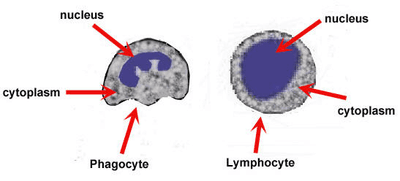

## Blood

### **Components of Blood**

| Component | Functions |
|----|----|
| Red blood cells | Contains haemoglobin - transporting oxygen |
| White blood cells | Phagocytosis and antibody production |
| Platelets | Blood clotting - to prevent blood loss and entry of pathogens |
| Plasma | Transport of blood cells, ions, nutrients, urea, hormones and carbon dioxide |

### **White Blood Cells**

 

| Type | Functions |
|----|----|
| Lymphocytes | Antibody production |
| Phagocytes | Engulfing pathogens by phagocytosis |

* \

